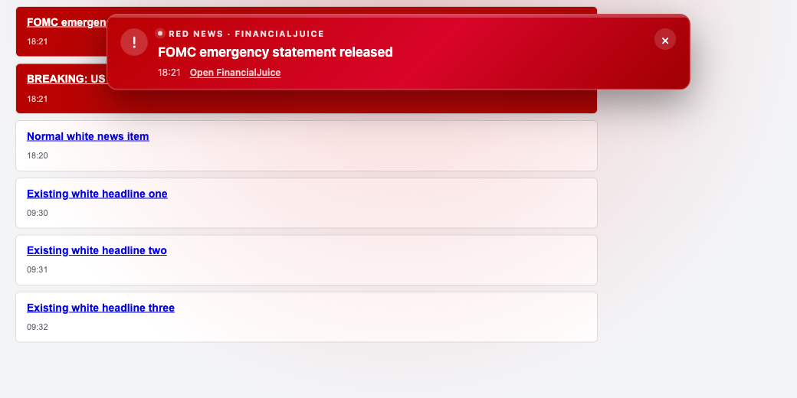
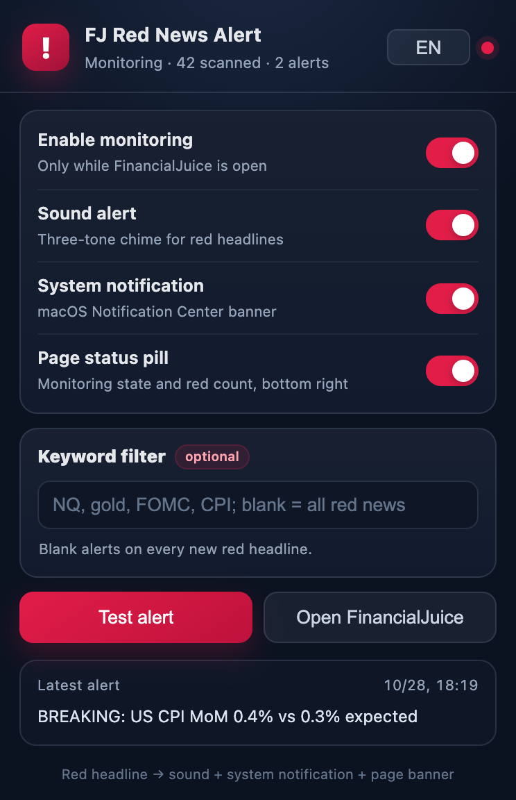

# FJ Red News Alert

**English** | [简体中文](README.zh-CN.md)

A local Chrome extension that watches **FinancialJuice** and reacts the moment a red headline appears:

1. Shows a red banner at the top of the page with the headline, time, and source link.
2. Plays a three-tone alert sound.
3. Sends a macOS system notification.
4. Adds a red `!` badge to the extension icon.

The interface supports English and Simplified Chinese. It only runs while `https://www.financialjuice.com/home` (or another page on the same domain) is open. It makes no network requests, uploads no data, and never places trades. Settings are stored locally with `chrome.storage`.

## Preview

Screenshots from a local mock feed; the real page uses the same top banner:





## Install (one time)

Requires Chrome/Chromium 109 or newer. Double-click `install.command`, or install manually:

1. Open `chrome://extensions`
2. Enable **Developer mode** in the top-right corner
3. Click **Load unpacked**
4. Select the `extension` folder in this repository
5. Return to FinancialJuice and press `⌘R` to reload the page
6. Optional: pin **FJ Red News Alert** from the extensions menu

The FinancialJuice tab must be reloaded after installing or updating the extension so the content script is injected.

## Usage

Click the extension icon in the toolbar:

- **Enable monitoring** — master switch.
- **Sound alert** — three-tone chime.
- **System notification** — macOS Notification Center banner.
- **Page status pill** — bottom-right indicator such as `FJ monitoring · red 3`.
- **Keyword filter** — for example `NQ, gold, FOMC, CPI`. Only red headlines containing at least one keyword trigger an alert; leave it blank to alert on every red headline.
- **Language** — Auto, English, or 简体中文. Auto follows the browser UI language.
- **Test alert** — triggers a complete alert immediately on the FinancialJuice page, so you can verify sound, notification, and banner.

## Detection rules

FinancialJuice renders breaking headlines like this:

```html
<div class="headline-item" data-headlineid="123">
  <div class="media feedWrap active"> ... </div>
</div>
```

`active` / `active-critical` are painted red by the site. The extension checks:

- whether `.feedWrap` has `active` / `active-critical`;
- whether the computed background color is red (a fallback for site changes);
- excludes blue `comm-news` company news.

Only red headlines that appear **after the extension starts** trigger an alert:

- red headlines already present when the page loads become the baseline and are not replayed;
- bulk inserts caused by switching feeds or loading history are ignored;
- a headline that turns red because it was clicked is ignored, since that is selection state rather than a new story.

## No notification?

1. Open **System Settings → Notifications → Google Chrome**, allow notifications, and choose “Banners” or “Alerts”.
2. Check that Chrome is not muted and that the macOS output device is working.
3. On the FinancialJuice page, click the extension icon → **Test alert**.
4. If it says the page is not connected, reload FinancialJuice. A reload is also required after installing or updating the extension.
5. The headline may have been filtered out by keywords; check the keyword field.

## Limitations

- The page must stay open. If Chrome discards or sleeps the tab, monitoring stops. Pin the tab and add `financialjuice.com` to Chrome’s “Always keep these sites active” list under **Settings → Performance → Memory Saver**.
- This is a news alert, not a trading signal. Use your own judgment.
- Chromium-based browsers only (Chrome, Edge, Brave, etc.); the notification experience is best on macOS.
- The extension never reads or stores credentials. It only uses `chrome.storage` for toggles and keywords.

## Layout

```text
financialjuice-alert/
├── extension/            # Load this folder in chrome://extensions
│   ├── manifest.json
│   ├── i18n.js           # English / Simplified Chinese UI strings
│   ├── detector.js       # Red-headline detection (unit tested)
│   ├── content.js        # DOM observer, banner, alert queue
│   ├── background.js     # Notifications, badge, sound dispatch
│   ├── offscreen.html/js # Plays alert.wav in the background
│   ├── popup.html/css/js # Settings panel
│   ├── alert.wav
│   ├── _locales/         # Localized extension name and description
│   └── icons/
├── test/                 # Local mock feed and unit tests
└── install.command
```

## Local testing

Pure detection logic:

```bash
node test/detector.test.js
```

Mock news feed (requires loading the test build, which matches `http://127.0.0.1:8899/*`):

```bash
./test/build-test-extension.sh
python3 -m http.server 8899 -d test
# In another terminal, load test/extension-test as an unpacked extension,
# then open http://127.0.0.1:8899/mock.html
```

The mock page inserts a red headline at 8 seconds and another at 10.4 seconds.

## Uninstall

`chrome://extensions` → FJ Red News Alert → **Remove**.
