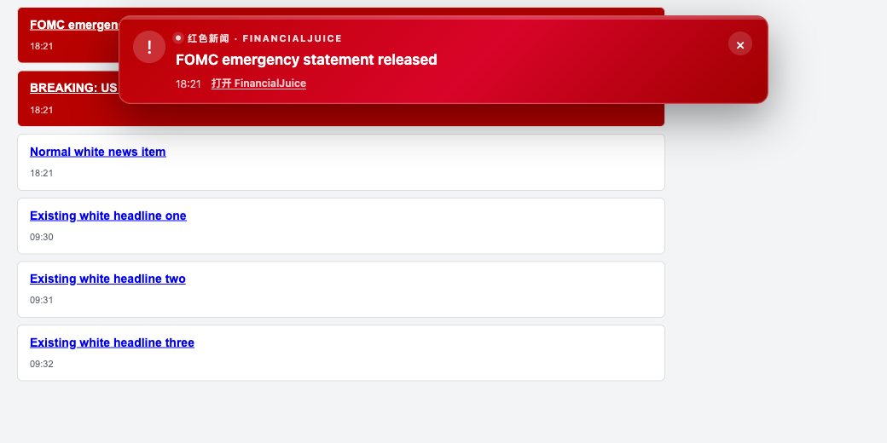
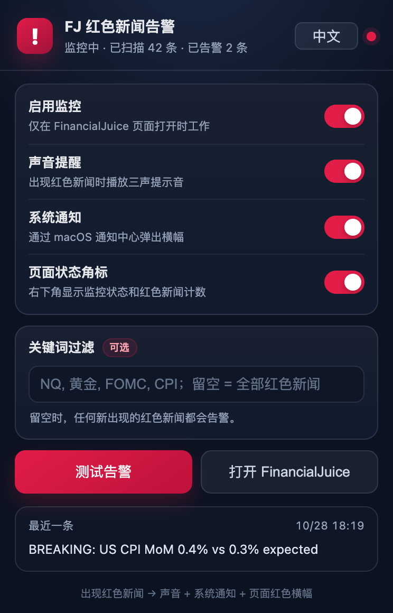

# FJ Red News Alert

[English](README.md) | **简体中文**

一个本地 Chrome 扩展：当 **FinancialJuice** 页面出现红色新闻时，立即

1. 在网页顶部弹出红色横幅（含新闻标题、时间、原文链接）；
2. 播放三声提示音；
3. 通过 macOS 通知中心弹出系统通知；
4. 在扩展图标上显示红色 `!` 角标。

界面支持中英文切换。它只在 `https://www.financialjuice.com/home`（以及同域页面）打开时工作，不联网、不上传任何数据，也不执行任何交易操作。

## 效果

下面是本地模拟新闻页上的测试效果（真实页面同样是顶部红色横幅）：





## 安装（只需一次）

双击 `install.command`，或在 Chrome 中手动操作：

1. 打开 `chrome://extensions`
2. 打开右上角 **开发者模式**
3. 点击 **加载已解压的扩展程序**
4. 选择本目录下的 `extension` 文件夹
5. 回到 FinancialJuice 页面，按 `⌘R` 刷新一次
6. 建议点击浏览器工具栏的拼图图标，把 **FJ Red News Alert** 固定出来

安装或更新扩展后，必须刷新 FinancialJuice 页面，内容脚本才会注入。

## 使用

点击工具栏中的扩展图标：

- **启用监控**：总开关。
- **声音提醒**：三声提示音。
- **系统通知**：macOS 通知横幅。
- **页面状态角标**：右下角显示 `FJ 监控中 · 红色 N`。
- **关键词过滤**：例如 `NQ, 黄金, FOMC, CPI`。只有标题包含任一关键词的红色新闻才告警；留空表示全部红色新闻都告警。
- **语言**：自动 / English / 简体中文。自动模式跟随浏览器界面语言。
- **测试告警**：在 FinancialJuice 页面立即触发一次完整告警，用来确认声音、通知和横幅是否正常。

## 判定规则

FinancialJuice 把突发新闻渲染成：

```html
<div class="headline-item" data-headlineid="123">
  <div class="media feedWrap active"> ... </div>
</div>
```

`active` / `active-critical` 会被站点样式绘制成红色背景。扩展同时检查：

- `.feedWrap` 是否带 `active` / `active-critical`；
- 计算后的背景色是否属于红色（兼容站点改版）；
- 排除蓝色的 `comm-news` 公司新闻。

只有**扩展启动后新出现**的红色新闻才会告警：

- 打开页面时已经存在的红色新闻会被当作基线，不会补报；
- 切换新闻分类、加载历史列表造成的整批插入会被忽略；
- 点击某条新闻导致的变红会被忽略，因为那是选中状态而不是新新闻。

## 通知没有出现？

1. 打开 **系统设置 → 通知 → Google Chrome**，确认允许通知，并选择“横幅”或“提醒”。
2. 检查 Chrome 是否静音、macOS 输出设备是否正常。
3. 在 FinancialJuice 页面点击扩展图标 → **测试告警**。
4. 如果提示“页面尚未连接”，刷新 FinancialJuice 页面；安装/更新扩展后也必须刷新。
5. 红色新闻可能被关键词过滤掉了，检查关键词输入框。

## 限制

- 页面必须保持打开。Chrome 将标签页“休眠/丢弃”后不会继续监控。建议固定该标签页，并在 Chrome「设置 → 性能 → 内存节省程序」中把 `financialjuice.com` 加入“始终保持这些网站处于活动状态”。
- 它不是交易信号，只是新闻提醒；请自行判断。
- 只支持 Chromium 内核浏览器（Chrome、Edge、Brave 等），macOS 通知体验最佳。
- 扩展不读取或保存账号密码，只使用 `chrome.storage` 保存开关和关键词。

## 目录

```text
financialjuice-alert/
├── extension/            # 加载这个文件夹
│   ├── manifest.json
│   ├── i18n.js           # 中英文界面文案
│   ├── detector.js       # 红色判定（可单测）
│   ├── content.js        # DOM 监听、横幅、告警队列
│   ├── background.js     # 系统通知、角标、声音调度
│   ├── offscreen.html/js # 后台播放 alert.wav
│   ├── popup.html/css/js # 设置面板
│   ├── alert.wav
│   ├── _locales/         # 扩展名称与描述的多语言资源
│   └── icons/
├── test/                 # 本地模拟页与检测单测
└── install.command
```

## 本地测试

纯检测逻辑：

```bash
node test/detector.test.js
```

模拟新闻页（需要加载测试版扩展，匹配 `http://127.0.0.1:8899/*`）：

```bash
./test/build-test-extension.sh
python3 -m http.server 8899 -d test
# 另一个终端用 Chrome 加载 test/extension-test，然后打开：
# http://127.0.0.1:8899/mock.html
```

模拟页会在第 8 秒和第 10.4 秒各插入一条红色新闻。

## 卸载

`chrome://extensions` → FJ Red News Alert → **移除**。
